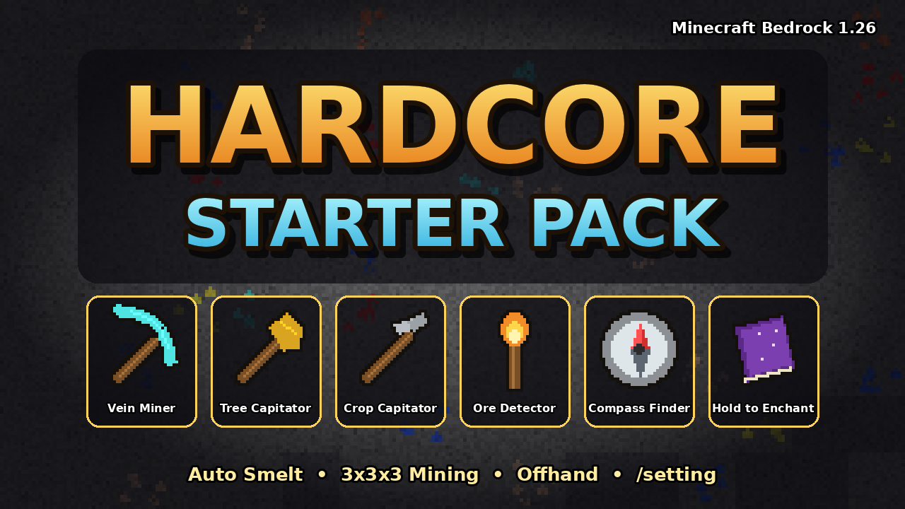

# Hardcore Starter Pack

Addon fungsi (tanpa tekstur baru) untuk Minecraft Bedrock **1.26.30+** (dibuat untuk **1.26.52**, Play Store).
Behavior pack + resource pack kecil (hanya nama & ikon item yang memakai tekstur vanilla), **tanpa Beta API**,
memakai Script API stabil `@minecraft/server` 2.4.0 dan `@minecraft/server-ui` 2.0.0.

| Fitur | Cara pakai |
|---|---|
| 🌳 **Tree Capitator** | **Jongkok** + pecah batang pohon dengan **kapak** |
| ⛏️ **Vein Miner** | **Jongkok** + pecah ore dengan **beliung** |
| 🔥 **Auto Smelt** | Ore yang ditambang saat **jongkok** langsung jadi batangan/hasil tungku |
| 🌾 **Crop Capitator** | **Jongkok** + panen tanaman matang dengan **cangkul** (otomatis tanam ulang) |
| 🧱 **3x3x3 Mining** | **Jongkok** + pecah blok biasa dengan **beliung / sekop / kapak** |
| ✨ **Hold to Enchant** | Pegang item apa pun yang bisa di-enchant → semua enchant level maksimal |
| ✋ **Offhand** | **Torch Detector** & **Compass Finder** bisa dipasang di tangan kiri; `/offhand` menukar tangan |
| 🔦 **Ore Detector** | **Torch Detector** di tangan kiri → koordinat 3 ore terdekat + cahaya obor |
| 🧭 **Compass Finder** | **Compass Finder** di tangan kiri → koordinat 3 struktur terdekat |
| ⚙️ **Menu** | Ketik **`/setting`** di chat |

---

## Cara Pasang
1. Unduh **[`dist/HardcoreStarterPack.mcaddon`](dist/HardcoreStarterPack.mcaddon)** lalu buka dengan Minecraft.
   (Alternatif: salin folder `HardcoreStarterPack_BP` ke `games/com.mojang/behavior_packs/`.)
2. Di pengaturan dunia → **Paket Perilaku** → aktifkan **Hardcore Starter Pack** (resource pack-nya ikut aktif otomatis).
3. Tidak perlu Beta API / eksperimen. Perintah `/setting` dan `/offhand` bisa dipakai **tanpa cheat**.

---

## Fitur Tambang & Panen (aktif saat jongkok)

Saat kamu jongkok dan memecah blok dengan alat yang cocok, addon mengambil alih pemecahan blok:
- **Drop dibuat dari loot table vanilla memakai alatmu**, jadi **Fortune** dan **Silk Touch** ikut berlaku
  (Fortune pada daun → peluang sapling/apel lebih besar; Fortune pada tanaman → panen lebih banyak; Fortune pada ore → lebih banyak).
- **Daya tahan alat berkurang 1 per blok yang hancur** (termasuk daun). Enchant **Unbreaking** tetap mengurangi peluangnya
  (Unbreaking III = 25%). Jika daya tahan habis, proses berhenti dan alat patah.
- **Animasi hancur:** setiap blok pecah dengan partikel & suara hancur vanilla, bergelombang dari blok pertama
  (Vein Miner, Tree Capitator, Crop Capitator ±1 detik; 3x3x3 pecah serentak).
- Semua barang dijatuhkan **bertumpuk di blok pertama** (sedikit entitas item = tidak lag), XP ore langsung masuk ke pemain.
- Tidak ada pemberitahuan jumlah blok atau daya tahan; alat yang patah hanya berbunyi seperti biasa.
- **Tidak bentrok dengan addon lain:** hanya blok vanilla (`minecraft:`) yang ikut dihancurkan; blok addon lain, blok berisi
  barang (peti, barel, dll), bedrock, portal, spawner, dan blok tak tergantikan lain tidak pernah disentuh.
  Tanpa jongkok, semuanya berjalan seperti vanilla.

| Fitur | Alat | Detail |
|---|---|---|
| **Tree Capitator** | Kapak | Semua batang sejenis yang tersambung (maks 256, bisa diubah) + daun alami dalam 6 blok. Bila tidak ada daun alami (misalnya bangunan dari kayu), hanya 1 blok yang dipecah. Mendukung semua kayu termasuk crimson/warped (wart block & shroomlight). |
| **Vein Miner** | Beliung | Ore sejenis yang tersambung (26 arah, maks 64, bisa diubah). Deepslate & redstone menyala dihitung sejenis. Beliung yang terlalu lemah (mis. kayu untuk besi) → perilaku vanilla. |
| **Auto Smelt** | Beliung | Bijih mentah → batangan (besi, emas, tembaga), ancient debris → netherite scrap, blok ore (Silk Touch) → hasil tungkunya. Berlaku di Vein Miner, 3x3x3, dan ore tunggal. |
| **Crop Capitator** | Cangkul | Gandum, wortel, kentang, bit, nether wart, kakao yang **matang** dan tersambung (maks 256). Tanam ulang otomatis (memakai 1 bibit dari hasil panen). Semangka & labu juga dipanen. Tanaman belum matang tidak disentuh. |
| **3x3x3 Mining** | Beliung / Sekop / Kapak | Kubus 3x3x3 di sekitar blok yang dipecah. Beliung: blok apa saja yang bisa ditambangnya (tier dicek); sekop: tanah, pasir, kerikil, salju, dll; kapak: blok kayu. Ore di dalamnya ikut Auto Smelt. |

Prioritas: ore + beliung → Vein Miner; batang + kapak → Tree Capitator; tanaman matang + cangkul → Crop Capitator; selain itu → 3x3x3.

---

## Hold to Enchant
Setiap kali kamu **memegang** (tangan kanan atau kiri) item yang bisa di-enchant, item itu otomatis mendapat **semua enchant
yang cocok pada level maksimal**:
- Termasuk enchant yang biasanya **tidak bisa digabung**, misalnya Sharpness + Smite + Bane of Arthropods, Infinity + Mending,
  Multishot + Piercing, Riptide + Loyalty + Channeling, semua jenis Protection, Depth Strider + Frost Walker, Density + Breach.
- **Fortune dan Silk Touch tidak pernah digabung**; pilih salah satu (atau tidak keduanya) di `/setting` → *Hold to Enchant*.
- **Enchant kutukan (Curse of Binding, Curse of Vanishing) tidak pernah dipasang.**
- Setiap enchant bisa dinyalakan/dimatikan di `/setting`. (Mematikan enchant hanya berlaku untuk item berikutnya; enchant
  yang sudah terpasang tidak dicabut.)
- Daya tahan, nama, lore, dan warna item tetap.

> Cara kerja enchant bentrok: Script API menolak menggabungkan enchant yang bentrok, jadi untuk item yang punya enchant bentrok
> (pedang, kapak, tombak, gada, busur, busur silang, trisula, armor) addon membuat salinan item dari loot table
> `loot_tables/hsp/enchant/*` berisi semua enchant, lalu menyalin daya tahan, nama, dan lore item lama.

---

## Offhand, Torch Detector & Compass Finder
Tangan kiri vanilla Bedrock **tidak menerima obor dan kompas biasa**, dan addon tidak bisa mengubah item vanilla.
Karena itu ada dua item baru yang **teksturnya sama persis dengan obor & kompas vanilla** (memakai file tekstur vanilla):

| Item | Resep (Meja Kerajinan, tanpa pola) | Fungsi di tangan kiri |
|---|---|---|
| **Torch Detector** | 1 Obor → 1 Torch Detector | Ore Detector |
| **Compass Finder** | 1 Kompas → 1 Compass Finder | Compass Finder |

Keduanya bisa dikembalikan lagi menjadi obor / kompas biasa (taruh 1 item di meja kerajinan).

Cara memasang ke tangan kiri:
- **Manual:** buka inventori lalu taruh item di **slot tangan kiri** (slot offhand), sama seperti perisai/totem.
- **Klik kanan** Torch Detector / Compass Finder saat dipegang di tangan kanan → langsung pindah ke tangan kiri.
- **`/offhand`** atau `/setting` → *Tukar Tangan*: menukar item tangan kanan ↔ kiri. Untuk item yang ditolak tangan kiri
  vanilla, addon mencoba lewat perintah; jika tetap ditolak, muncul pesan agar memakai Torch Detector / Compass Finder.

## Ore Detector (Torch Detector di tangan kiri)
Pasang **Torch Detector** di tangan kiri (obor biasa/jiwa/tembaga juga dikenali jika berhasil dipasang ke tangan kiri):
- Actionbar menunjukkan **3 ore terdekat** lengkap dengan **koordinat**, jarak, dan arah, misalnya:
  ```
  [Detektor] 12 ore dalam 16 blok
  Berlian 104 -58 -233 (5m ↗▼)
  Emas 98 -55 -240 (9m ←)
  Besi 101 -52 -228 (11m ↑▲)
  ```
  Blok ore sejenis yang berdempetan dihitung satu (jadi 3 baris = 3 lokasi berbeda). Arah relatif terhadap pandanganmu
  (`↑ ↗ → ↘ ↓ ↙ ← ↖`, `▲`/`▼` jika lebih tinggi/rendah ≥ 2 blok).
- Partikel api biru kecil di depan mata menunjuk ke ore terdekat.
- **Cahaya obor:** Torch Detector yang dipegang (tangan kiri atau kanan) menerangi sekitarmu seperti obor sungguhan.
  Cahaya ikut berpindah dan otomatis hilang saat obor dilepas (bisa dimatikan di `/setting`).
- Jarak deteksi bawaan 16 blok (8–24 di `/setting`), setiap jenis ore bisa dimatikan.
- Hemat lag: memakai pencarian blok bawaan game (`getBlocks`), memindai ulang hanya saat kamu berpindah blok atau tiap 2 detik.

## Compass Finder (Compass Finder di tangan kiri)
Pasang **Compass Finder** di tangan kiri (kompas biasa juga dikenali jika berhasil dipasang) → actionbar menunjukkan
**3 struktur terdekat** yang sudah dikenali lengkap dengan **koordinat**, jarak, dan arah, misalnya:
```
[Kompas] 5 struktur dikenal
Village 240 70 -112 (143m ↗)
Trial Chamber 180 -20 -60 (210m ←▼)
Ruined Portal 300 66 -10 (260m ↘)
```
plus partikel hijau penunjuk arah ke yang terdekat. Struktur yang didukung (bisa dinyalakan/dimatikan satu per satu di `/setting`):

Village, Nether Fortress, Camp (Abandoned Camp), Trial Chamber, Trail Ruins, Stronghold, Ancient City, Pillager Outpost,
Woodland Mansion, Dungeon, Buried Treasure, Ruined Portal, Desert Temple, Cave, Mineshaft, Ocean Monument, Lava Pool,
Amethyst Geode, Ravine, Jungle Temple, Fossil, Shipwreck, Witch Hut, Ocean Ruin, Igloo, Desert Well, Bastion Remnant,
End City, End Gateway.

> **Penting, cara kerjanya:** Script API Bedrock **tidak punya fungsi "locate"** (perintah `/locate` juga tidak mengembalikan
> koordinat ke script). Karena itu kompas **memindai chunk yang sudah termuat di sekitarmu** (bawaan 3 chunk, 2–6 di `/setting`)
> dan mengenali struktur dari **blok khasnya**, misalnya bel desa, trial spawner, end portal frame (stronghold),
> reinforced deepslate (ancient city), budding amethyst (geode), spawner + mossy cobblestone (dungeon), peti di bawah pasir
> (buried treasure), dan sebagainya. Struktur yang pernah ditemukan **disimpan di memori dunia**, jadi kompas tetap bisa
> menuntunmu kembali ke sana dari jauh. Semakin banyak menjelajah, semakin banyak tujuan yang dikenal.
> Deteksi berbasis blok khas ini bersifat **perkiraan** (terutama Cave, Ravine, Lava Pool, Camp), dan struktur yang belum
> pernah kamu dekati belum bisa ditunjukkan. Memori bisa dihapus di `/setting` → *Compass Finder*.

---

## Menu `/setting`
Ketik `/setting` di chat lalu **tutup chat**, menu akan terbuka:
- **Tambang & Panen**: nyalakan/matikan Tree Capitator, Vein Miner, Auto Smelt, Crop Capitator, 3x3x3, batas blok.
- **Hold to Enchant**: aktif/nonaktif, pilihan Fortune / Silk Touch / tanpa keduanya, dan saklar setiap enchant.
- **Ore Detector**: aktif/nonaktif, cahaya obor, jarak deteksi, saklar setiap jenis ore.
- **Compass Finder**: aktif/nonaktif, jangkauan pindai, hapus memori, saklar setiap struktur.
- **Tukar Tangan (Offhand)**.

Pengaturan disimpan **per pemain**.

---

## Untuk Pengembang
```
Hardcore_Starter_Pack/
  HardcoreStarterPack_RP/      ikon & nama Torch Detector / Compass Finder (tekstur vanilla)
  HardcoreStarterPack_BP/
    manifest.json
    items/                     torch_detector.json, compass_finder.json (allow_off_hand)
    recipes/                   obor <-> Torch Detector, kompas <-> Compass Finder
    loot_tables/hsp/enchant/   68 loot table enchant bentrok (dibuat tools/buat_loot.py)
    scripts/
      main.js        perintah /setting & /offhand, menyalakan semua sistem
      data.js        tabel ore, hasil lebur, tanaman, kayu/daun, tier alat, blok terlarang
      tambang.js     Tree Capitator, Vein Miner, Auto Smelt, Crop Capitator, 3x3x3 + animasi hancur
      enchant.js     Hold to Enchant
      detektor.js    Ore Detector (3 ore terdekat + koordinat)
      cahaya.js      cahaya Torch Detector (blok cahaya tak terlihat yang ikut berpindah)
      struktur.js    aturan blok khas setiap struktur + memori struktur
      kompas.js      Compass Finder (pemindaian bertahap + navigasi)
      pengaturan.js  pengaturan per pemain + menu
      util.js        helper (navigasi, actionbar, gabung drop)
  tools/
    buat_cover.py    generator cover (docs/cover.png) & pack_icon.png
    buat_loot.py     generator loot table enchant
    build.sh         membuat dist/*.mcaddon & *.mcpack
  dist/
```
Membangun ulang: `python3 tools/buat_loot.py && python3 tools/buat_cover.py && ./tools/build.sh`.

## Masalah Umum
| Masalah | Solusi |
|---|---|
| `/setting` tidak dikenali | Pastikan pack aktif. Jika bentrok nama dengan addon lain, pakai `/hsp:setting` (dan `/hsp:offhand`). |
| Menu tidak muncul | Tutup layar chat dulu; menu menunggu sampai chat tertutup. |
| Fitur tambang tidak jalan | Harus **jongkok**, mode Survival/Adventure, alat yang cocok, dan fitur menyala di `/setting`. |
| Obor/kompas biasa tidak mau masuk tangan kiri | Itu batasan vanilla; craft **Torch Detector** / **Compass Finder**. |
| Kompas belum menunjuk apa pun | Jelajahi area baru; kompas hanya mengenali struktur di chunk yang sudah dimuat (lihat penjelasan di atas). |
| Ingin melihat error | *Pengaturan → Kreator → Content Log GUI* (nyalakan), lalu kirim isi log saat melapor. |
