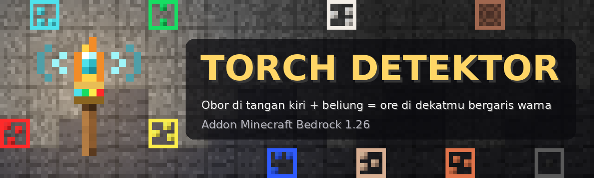
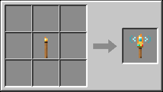
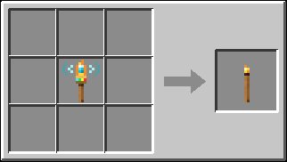
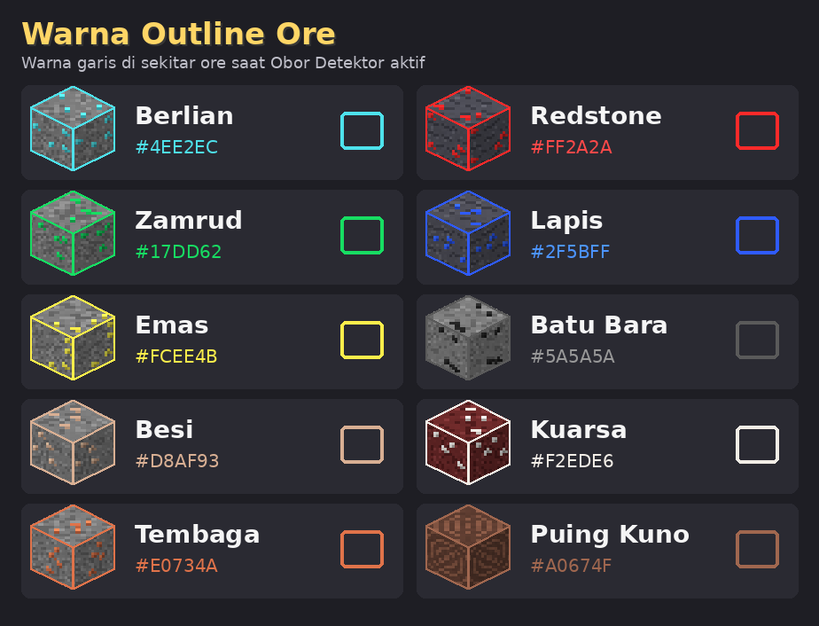

# Torch Detektor: Addon Pendeteksi Ore untuk Minecraft Bedrock

**Torch Detektor** menambahkan **Obor Detektor**, obor yang dipegang di **tangan kiri (offhand)**.
Obor ini dibuat dari **1 obor biasa** di meja kerja. Selama kamu **memegang beliung di tangan kanan**,
ore di sekitarmu ditandai dengan **outline berwarna sesuai jenis ore**, dan HUD radar di layar
memberi tahu jarak serta arah ore terdekat. Jangkauannya sengaja **pendek** (4 sampai 8 blok) supaya
tidak membuat game lag di HP.

| | |
|---|---|
| **Versi game** | Minecraft Bedrock **1.26.30 ke atas** (dibuat untuk **1.26.52**, Play Store) |
| **Pack inti** | `@minecraft/server` 2.4.0 + `@minecraft/server-ui` 2.0.0 (stabil, **tidak perlu Beta API**) |
| **Pack X-Ray (opsional)** | `@minecraft/debug-utilities` 1.0.0-beta, **butuh eksperimen "Beta APIs"** |
| **Mode** | Survival & Kreatif |
| **Pemain** | Satu pemain & multipemain (setiap pemain punya pengaturan sendiri) |

---

## Daftar Isi
1. [Fitur](#fitur)
2. [Dua Mode Tampilan (Penjelasan Jujur)](#dua-mode-tampilan-penjelasan-jujur)
3. [Cara Pasang (Android / Play Store)](#cara-pasang-android--play-store)
4. [Mengaktifkan di Dunia](#mengaktifkan-di-dunia)
5. [Resep](#resep)
6. [Cara Pakai](#cara-pakai)
7. [Jangkauan per Beliung](#jangkauan-per-beliung)
8. [Warna Ore](#warna-ore)
9. [Kinerja (Kenapa Tidak Bikin Lag)](#kinerja-kenapa-tidak-bikin-lag)
10. [Untuk Pengembang](#untuk-pengembang)
11. [Masalah Umum](#masalah-umum)

---

## Fitur

- 🔦 **Obor Detektor** di tangan kiri, dibuat dari obor biasa (dan bisa dikembalikan jadi obor biasa).
- ⛏️ **Aktif hanya saat memegang beliung** di tangan kanan. Lepas beliung → detektor mati sendiri.
- 🟦 **Outline berwarna** di setiap ore, warnanya mewakili ore tersebut (berlian biru muda, emas kuning, dst).
- 📡 **HUD radar** di atas hotbar: 3 jenis ore terdekat, jarak, dan panah arah. Bekerja **menembus dinding**.
- 📏 **Jangkauan tergantung beliung**: beliung kayu 4 blok sampai netherite 8 blok.
- 💡 **Cahaya obor**: area di sekitarmu ikut terang selama Obor Detektor ada di tangan kiri.
- ⚙️ **Menu pengaturan** per pemain: nyalakan/matikan outline, HUD, cahaya, batas radius, dan jenis ore.
- 🧱 **Mode X-Ray opsional** (Beta APIs): kotak garis berwarna yang terlihat **menembus dinding**.

---

## Dua Mode Tampilan (Penjelasan Jujur)

Minecraft Bedrock **tidak punya cara yang stabil** untuk menggambar garis yang terlihat menembus
dinding. Karena itu addon ini dibagi menjadi dua mode:

### 1. Mode biasa: outline partikel + HUD radar (stabil, tanpa Beta API)
- Outline digambar dengan **partikel** berbentuk bingkai di sisi-sisi blok ore.
- Partikel **tertutup oleh blok lain**. Artinya outline **hanya terlihat kalau sisi ore itu terbuka**,
  misalnya ore di dinding gua, jurang, atau ore yang sudah kamu gali sebagian.
- Ore yang terkubur di dalam batu **tidak terlihat outline-nya**, tetapi tetap **muncul di HUD radar**
  (teks di atas hotbar) lengkap dengan jarak dan arah. Ikuti panahnya lalu gali.
- Outline hanya terlihat oleh pemain pemegang obor itu sendiri.

### 2. Mode X-Ray: kotak wireframe menembus dinding (opsional, butuh Beta APIs)
- Pasang dan aktifkan juga pack **Torch Detektor X-Ray (Beta)** dan nyalakan eksperimen **Beta APIs**.
- Setiap ore diberi **kotak garis berwarna** yang **terlihat menembus dinding**, hanya untuk pemain
  pemegang obor.
- Saat X-Ray aktif, outline partikel otomatis berhenti digambar (diganti kotak X-Ray). HUD radar tetap jalan.
- ⚠️ X-Ray memakai modul **beta** (`@minecraft/debug-utilities`). Modul beta bisa berubah atau
  **rusak setelah update Minecraft**. Kalau itu terjadi, matikan saja pack X-Ray; pack inti tetap berfungsi.
- Beta APIs juga membuat dunia ditandai sebagai dunia eksperimen (pencapaian Xbox bisa nonaktif).
  Sebaiknya coba dulu di **salinan dunia**.

---

## Cara Pasang (Android / Play Store)

### Cara 1: file `.mcaddon` (paling mudah)
1. Unduh **[`dist/TorchDetektor.mcaddon`](dist/TorchDetektor.mcaddon)** dari repo ini (tombol *Download raw file*).
2. Buka file tersebut dari aplikasi *File* / *Unduhan*, lalu pilih **Minecraft**.
3. Tunggu sampai muncul pesan *Import berhasil* untuk **Torch Detektor BP**, **Torch Detektor RP**,
   dan **Torch Detektor X-Ray (Beta)**.

Tersedia juga file terpisah di folder `dist/`: `TorchDetektor_BP.mcpack`, `TorchDetektor_RP.mcpack`,
dan `TorchDetektor_XRay_BP.mcpack`.

### Cara 2: salin folder manual
Salin folder berikut ke:
```
Android/data/com.mojang.minecraftpe/files/games/com.mojang/behavior_packs/TorchDetektor_BP
Android/data/com.mojang.minecraftpe/files/games/com.mojang/behavior_packs/TorchDetektor_XRay_BP   (opsional)
Android/data/com.mojang.minecraftpe/files/games/com.mojang/resource_packs/TorchDetektor_RP
```

---

## Mengaktifkan di Dunia

1. Buka pengaturan dunia (baru atau lama) → **Paket Perilaku (Behavior Packs)**.
2. Aktifkan **Torch Detektor BP** (wajib). Resource pack **Torch Detektor RP** ikut aktif otomatis.
3. **Opsional, untuk X-Ray:**
   - Aktifkan juga **Torch Detektor X-Ray (Beta)**.
   - Buka **Eksperimen** → nyalakan **Beta APIs**.
   - **Jangan** mengaktifkan pack X-Ray tanpa **Torch Detektor BP**. Pack X-Ray tidak memindai ore
     sendiri; ia hanya menggambar data yang dikirim pack inti.
4. Masuk ke dunia.

---

## Resep

Dibuat di **meja kerja (crafting table)**, tanpa pola (shapeless). Resep langsung terbuka.

**Obor Detektor** = 1 Obor biasa → 1 Obor Detektor



**Kembali ke obor biasa** = 1 Obor Detektor → 1 Obor



> Obor Detektor tidak bisa ditumpuk (maksimal 1 per slot).

---

## Cara Pakai

1. **Pasang obor di tangan kiri.** Pegang Obor Detektor di tangan kanan lalu **klik kanan / ketuk tahan**
   (pakai item). Obor otomatis pindah ke tangan kiri (offhand), bertukar dengan isi tangan kirimu.
   Kamu juga bisa memindahkannya lewat slot offhand di inventaris seperti biasa.
2. **Pegang beliung** apa saja di tangan kanan. Terdengar bunyi *ding* dan muncul **§aDetektor ON**.
3. Ore di sekitarmu sekarang ditandai outline berwarna, dan HUD radar muncul di atas hotbar, contohnya:
   ```
   Detektor r6 | ■ Berlian 3m ↑  ■ Emas 5m ↗▼  +4
   ```
   - `r6` = radius deteksi yang sedang dipakai (6 blok).
   - Panah `↑ ↗ → ↘ ↓ ↙ ← ↖` = arah ore dibanding arah pandanganmu (`↑` = di depanmu).
   - `▲` / `▼` = ore lebih tinggi / lebih rendah minimal 2 blok.
   - `+4` = masih ada 4 ore lain dalam jangkauan.
   - Jika kosong: `tidak ada ore di dekatmu`.
4. Ganti item di tangan kanan selain beliung → muncul **Detektor OFF** dan outline hilang.
5. **Pengaturan:** pegang Obor Detektor di tangan kanan, **jongkok + klik kanan** (pakai item).
   Menu **Pengaturan Obor Detektor** berisi:
   - Outline warna di ore (nyala/mati)
   - HUD radar (nyala/mati)
   - Cahaya obor (nyala/mati)
   - Batas radius 3 sampai 8 blok
   - Pilihan jenis ore yang mau dideteksi
6. **Cahaya obor:** selama Obor Detektor ada di tangan kiri (tidak perlu beliung), blok tempatmu berdiri
   ikut terang seperti membawa obor. Cahaya pindah mengikuti langkahmu dan hilang saat obor dilepas.

---

## Jangkauan per Beliung

Radius yang dipakai = **yang lebih kecil** antara radius beliung dan "Batas radius" di pengaturan.

| Beliung di tangan kanan | Radius maksimum |
|---|---|
| Beliung Kayu | 4 blok |
| Beliung Emas | 4 blok |
| Beliung Batu | 5 blok |
| Beliung Tembaga | 5 blok |
| Beliung Besi | 6 blok |
| Beliung Berlian | 7 blok |
| Beliung Netherite | 8 blok |
| Beliung lain (mis. dari addon lain, bertag `minecraft:is_pickaxe`) | 5 blok |

---

## Warna Ore



HUD radar menampilkan 3 jenis dengan ore terdekat; bila jaraknya sama, urutan tabel ini jadi pemecah seri.

| Ore | Warna | Blok yang dideteksi |
|---|---|---|
| Berlian | `#4EE2EC` | diamond_ore, deepslate_diamond_ore |
| Zamrud | `#17DD62` | emerald_ore, deepslate_emerald_ore |
| Emas | `#FCEE4B` | gold_ore, deepslate_gold_ore, nether_gold_ore |
| Besi | `#D8AF93` | iron_ore, deepslate_iron_ore |
| Tembaga | `#E0734A` | copper_ore, deepslate_copper_ore |
| Redstone | `#FF2A2A` | redstone_ore, deepslate_redstone_ore (termasuk yang sedang menyala) |
| Lapis | `#2F5BFF` | lapis_ore, deepslate_lapis_ore |
| Batu Bara | `#5A5A5A` | coal_ore, deepslate_coal_ore |
| Kuarsa | `#F2EDE6` | quartz_ore (Nether) |
| Puing Kuno | `#A0674F` | ancient_debris (Nether) |

Detektor berfungsi di Overworld, Nether, dan End.

---

## Kinerja (Kenapa Tidak Bikin Lag)

- **Jarak pendek (4 sampai 8 blok).** Jumlah blok yang diperiksa naik sangat cepat kalau radius
  diperbesar (radius 8 sudah sekitar 4.900 blok, radius 16 hampir 36.000 blok). Jarak pendek menjaga HP tetap lancar.
- **Pemindaian dilakukan game, bukan satu per satu.** Addon meminta game mencari hanya blok ore yang
  diaktifkan dalam kubus di sekitar kepalamu.
- **Batas jumlah:** paling banyak **64 ore** terdekat yang disimpan per pemain, dan hanya **24 ore** terdekat
  yang diberi outline partikel.
- **Pindai ulang hanya bila perlu:** saat detektor baru menyala, saat kamu pindah blok, saat pengaturan
  berubah, saat ada blok dipecah/dipasang di dekatmu, atau paling lambat tiap 2 detik (40 tick).
  Ore yang kamu pecah langsung hilang dari daftar.
- Detektor hanya bekerja saat obor di tangan kiri **dan** beliung di tangan kanan. Di luar itu tidak ada pemindaian.
- Kalau HP masih terasa berat, turunkan **Batas radius** atau matikan jenis ore yang tidak kamu perlukan.

---

## Untuk Pengembang

### Struktur folder
```
Torch_Detektor/
  TorchDetektor_BP/            pack inti (stabil)
    manifest.json
    items/obor_detektor.json   item td:obor_detektor (offhand, custom component td:obor)
    recipes/                   obor_detektor.json, obor_jadi_torch.json
    scripts/
      main.js                  titik masuk (daftar custom component, mulai loop)
      config.js                tabel ORE, radius per beliung, konstanta
      pengaturan.js            pengaturan per pemain (dynamic property td:atur) + form
      deteksi.js               aktif/nonaktif, pemindaian, cache, event blok pecah/dipasang
      gambar.js                outline partikel + kirim data ke pack X-Ray
      hud.js                   teks radar actionbar
      cahaya.js                cahaya obor (light_block_14)
      util.js                  helper kecil
  TorchDetektor_XRay_BP/       pack X-Ray opsional (Beta APIs)
    scripts/main.js            kotak DebugBox dari @minecraft/debug-utilities
  TorchDetektor_RP/            tekstur item, partikel td:garis_xy & td:garis_xz, teks bahasa
  tools/
    buat_aset.py               generator PNG (ikon, tekstur partikel, pack_icon, gambar resep, legenda warna)
    build.sh                   membuat dist/*.mcaddon & *.mcpack
  docs/                        gambar untuk README
  dist/                        hasil build
```

### Protokol scriptevent (pack inti ↔ pack X-Ray)
Pack X-Ray tidak memindai blok; semua data datang dari pack inti lewat `system.sendScriptEvent`.

| Id | Arah | Isi |
|---|---|---|
| `td:xray_hidup` | X-Ray → inti | `"1"`, dikirim tiap 40 tick. Inti menganggap X-Ray aktif jika detak terakhir ≤ 100 tick lalu. |
| `td:ore` | inti → X-Ray | JSON `{"p": player.id, "d": dimension.id, "w": {"<idxWarna>": "RRGGBB"}, "o": [[x, y, z, idxWarna], ...]}` |

- `td:ore` dikirim setiap hasil pindai berubah dan minimal tiap 40 tick selama aktif, **hanya** jika X-Ray aktif.
- Saat detektor mati dikirim sekali `{"p": id, "o": []}` untuk menghapus semua kotak pemain itu.
- Panjang pesan ≤ 2000 karakter (ore terjauh dibuang sampai muat, maksimal 64 ore).
- `idxWarna` = indeks di tabel `ORE` (`config.js`).

### Build
```bash
cd Torch_Detektor
python3 tools/buat_aset.py   # buat ulang semua gambar PNG (Pillow)
./tools/build.sh             # buat dist/TorchDetektor.mcaddon dan tiga file .mcpack
```

### UUID
| Pack | Header | Modul |
|---|---|---|
| Torch Detektor BP | `8cb0309f-4e28-40ff-8bf3-549fe4cc51bb` | data `35e64eb7-2647-4c87-85d2-e8720e63254f`, script `521a6be8-e327-4a18-848f-54fb22ed0b30` |
| Torch Detektor RP | `006160db-42e3-4049-8301-19764fbb6338` | resources `056f8cfb-24f4-4d51-b4e5-2c998c5cc0c3` |
| Torch Detektor X-Ray (Beta) | `1cddd970-f376-44c6-8762-300a14df4e20` | script `a530845e-6b7a-409b-a36a-a547aa7f817b` |

---

## Masalah Umum

**Obor tidak bisa dibuat / item tidak muncul**
- Pastikan **Torch Detektor BP** aktif di dunia itu dan versi Minecraft minimal **1.26.30**.
- Nyalakan **Pengaturan → Kreator → Content Log GUI** (Log Konten) lalu masuk ulang ke dunia untuk melihat pesan galat.

**Detektor tidak menyala**
- Obor Detektor harus di **tangan kiri** dan **beliung** di tangan kanan. Obor di tangan kanan tidak mendeteksi apa pun.
- Cek menu pengaturan (jongkok + klik kanan obor): mungkin semua jenis ore atau HUD/outline sedang dimatikan.

**HUD menunjukkan ore, tapi outline tidak terlihat**
- Itu normal di mode biasa: ore tertutup batu sehingga partikel outline tidak terlihat. Ikuti panah HUD
  dan gali, atau pakai mode X-Ray.

**Outline tidak muncul sama sekali, termasuk di gua**
- Pastikan **Torch Detektor RP** aktif (biasanya otomatis bersama BP).
- Pastikan pengaturan **Outline warna di ore** menyala.

**Kotak X-Ray tidak muncul**
- Cek **Eksperimen → Beta APIs** sudah menyala di dunia itu.
- Pastikan **Torch Detektor BP** juga aktif (X-Ray tidak bisa bekerja sendirian).
- Buka Content Log: jika ada galat soal `@minecraft/debug-utilities`, kemungkinan modul beta berubah setelah
  update game. Matikan pack X-Ray; outline partikel dan HUD akan dipakai lagi secara otomatis.

**Ada blok cahaya tak terlihat yang tertinggal**
- Addon mencatat posisi cahaya dan membersihkannya saat dunia dimuat ulang. Jika chunk-nya belum termuat,
  pembersihan dicoba lagi secara berkala (tiap 2 detik) sampai chunk itu termuat, mis. saat kamu kembali ke dekatnya.
